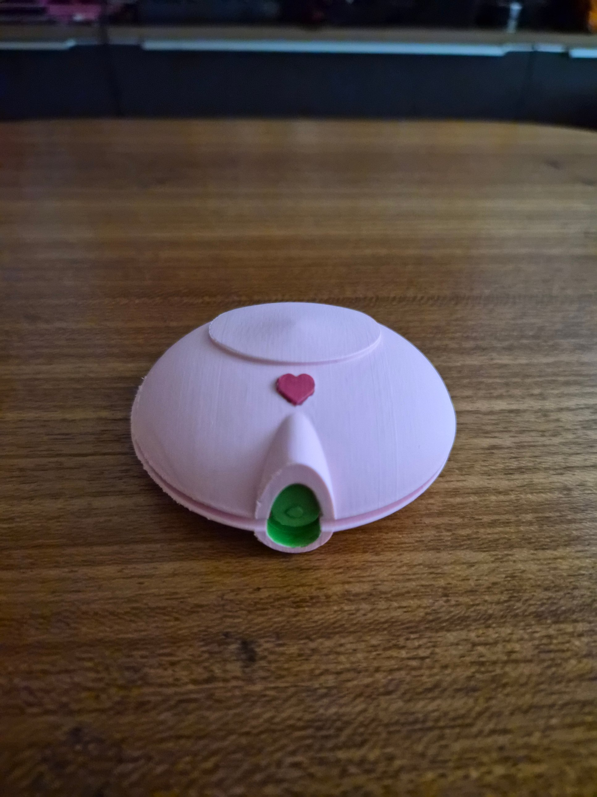
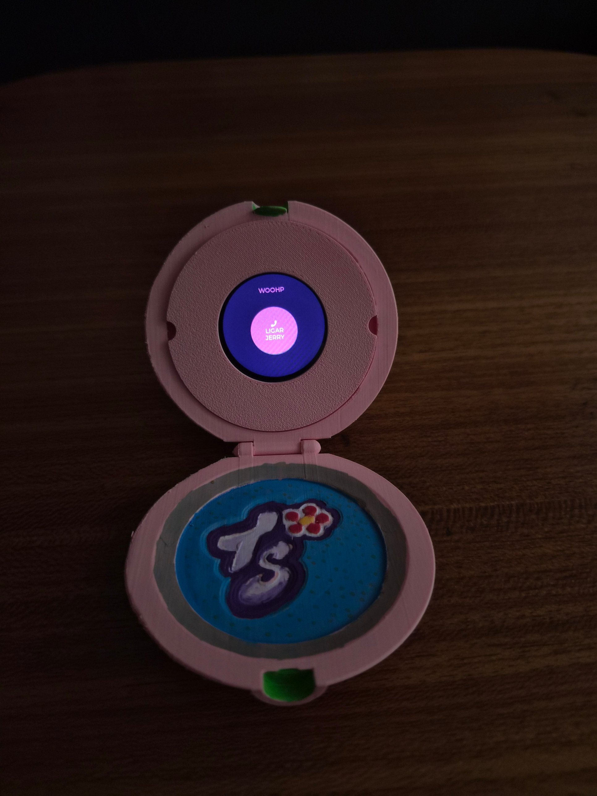
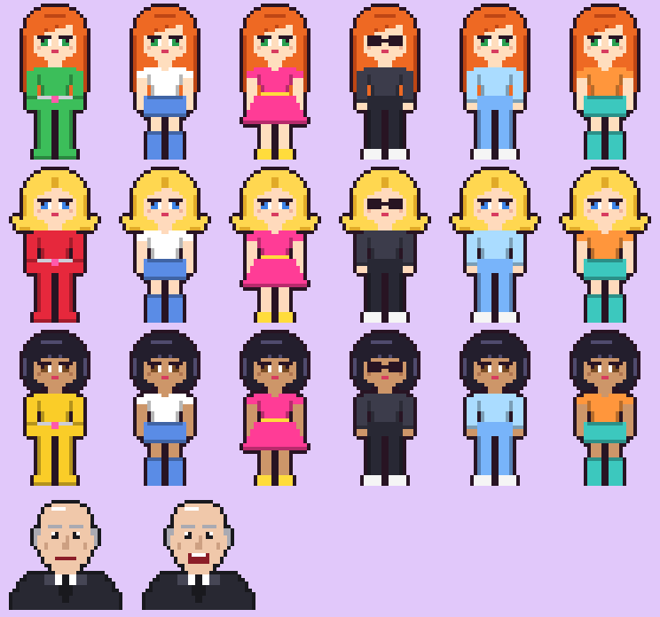
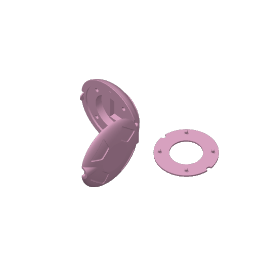
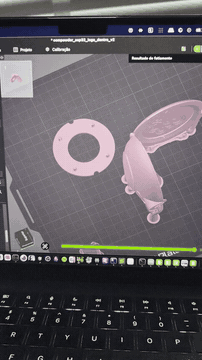

# 💗 Totally Spies ComPowder — ESP32

Um **compowder** das *Totally Spies!* impresso em 3D, com uma tela redonda touch
de ESP32 dentro da tampa rodando o **ComPowder OS**: guarda-roupa das spies em
pixel art 8-bit, chamada da WOOHP com o Jerry e um mini game de missão.

> *A Totally Spies 3D-printed compowder with a round ESP32-S3 touch display inside.
> Pick outfits for Sam, Clover and Alex, call Jerry at WOOHP, and play a laser-dodging mission.*

<p align="center">
  
  &nbsp;
  
</p>

---

## ✨ O que ele faz

O firmware é baseado no [ComPowderOS](https://github.com/esha-ahmed/Totally-Spies-ComPowder)
de **esha-ahmed**: cada app é uma tela LVGL e um *swipe* para a esquerda/direita troca de app.

| App | O que faz |
|---|---|
| 👗 **Guarda-roupa** | Escolha **Sam**, **Clover** ou **Alex** (bolinhas coloridas) e troque a roupa com as setas: *Spy Suit, Passeio, Festa, Disfarce, Pijama, Praia*. A escolha fica salva na flash. |
| 📞 **Jerry (WOOHP)** | Toque em **LIGAR JERRY** → "chamando..." → o Jerry aparece no monitor (com a boca animada) e passa a missão. Toque para avançar a fala. |
| 🎮 **Missão** | Arraste o dedo para mover a spy (com a roupa escolhida!). Desvie dos lasers vermelhos e pegue **10 gadgets** — você tem 3 vidas. No fim o Jerry liga de volta com o resultado. |

<p align="center">
  
  <br><sub>Todos os sprites gerados por <code>tools/gen_sprites.py</code> (28×44 px, paleta de 16 cores)</sub>
</p>

---

## 🧰 Hardware

| Item | Detalhe |
|---|---|
| Placa | **Waveshare ESP32-S3-Touch-LCD-1.28** — tela redonda 240×240 GC9A01 + touch CST816S |
| Bateria (opcional) | LiPo 3,7 V pequena (ex.: 502030, 250 mAh) no conector de bateria da placa |
| Impressora | Bambu Lab A1 mini, bico 0,2 mm (o 3MF já vem configurado) |
| Filamento | PLA — rosa no corpo, verde nas travas, mais cores no logo "TS" |

### Pinagem (já configurada no `.ino`)

| Sinal | GPIO (Waveshare 1.28) | GPIO (placa do repo original) |
|---|---|---|
| TFT SCK / MOSI | 10 / 11 | 3 / 10 |
| TFT CS / DC / RST | 9 / 8 / 14 | 2 / 18 / 21 |
| Backlight | 2 | 42 |
| Touch SDA / SCL | 6 / 7 | 8 / 9 |
| Touch RST / INT | 13 / 5 | 0 / 11 |

Troque entre as duas placas com `#define BOARD_WAVESHARE_128 1` / `0` no `ComPowderOS.ino`.

---

## 🖨️ Impressão 3D

O arquivo [`hardware/compowder_esp32.3mf`](hardware/compowder_esp32.3mf) é um projeto do
**Bambu Studio** com duas peças na mesma placa:

- **`compowder_esp32_corpo`** — base + tampa articulada, com o logo **"TS" com a florzinha**
  gravado no rebaixo da base;
- **`aro_esp32`** — o aro que segura a tela: encaixa por pressão na tampa com pinos
  (sem parafusos) e pode ser puxado para tirar a placa.

Configuração salva no projeto: PLA, camada **0,12 mm**, infill 15 %, **suportes ligados**.

<p align="center">
  
  &nbsp;
  
</p>

### Montagem

1. Imprima o 3MF e remova os suportes.
2. (Opcional) pinte o logo "TS" — no meu, o fundo é azul com bolinhas e a flor em vermelho/amarelo.
3. Grave o firmware na placa **antes** de montar (veja abaixo).
4. Coloque a placa na tampa, com a tela aparecendo pelo lado de dentro (visível ao abrir), e encaixe o **aro** por cima apertando os pinos.
5. Se usar bateria, ligue no conector da placa e acomode dentro da tampa antes de fechar o aro.

---

## 💻 Firmware

### Bibliotecas

| Biblioteca | Versão |
|---|---|
| `Arduino_GFX_Library` | **1.4.7** |
| `lvgl` | **8.3.x** ⚠️ *(não use a 9)* |

`lv_conf.h`: `LV_COLOR_DEPTH 16`. Funciona com `LV_COLOR_16_SWAP` 0 ou 1 e com
`LV_TICK_CUSTOM` 0 ou 1. Precisa de `LV_USE_CANVAS`, `LV_USE_SPINNER` e
`LV_FONT_MONTSERRAT_14` (já são o padrão).

### Configuração da Arduino IDE

- **Board:** ESP32S3 Dev Module
- **USB CDC On Boot:** Enabled
- **Flash Size:** 16MB
- **PSRAM:** QSPI PSRAM

Abra `firmware/ComPowderOS/ComPowderOS.ino` e faça o upload. No Serial Monitor
(115200) deve aparecer `ComPowder OS: boot completo!`.

### Apps do repo original (opcional)

Para incluir também **Radar / Spotify / Net Scanner** do ComPowderOS original, copie
`apps.h` e `apps.cpp` do [repo da esha-ahmed](https://github.com/esha-ahmed/Totally-Spies-ComPowder)
para `firmware/ComPowderOS/` e mude `#define USE_REPO_APPS 1`.

---

## 🎨 Personalizando

### Novas roupas

Adicione uma linha na tabela `OUTFITS` em `spy_apps.cpp` (máx. 12):

```cpp
{ "BALADA", ST_DRESS, 0x8A2BE2, 0xFFD700, false },
//  nome    estilo    cor A     cor B    óculos?
```

Estilos disponíveis: `ST_CATSUIT`, `ST_DRESS`, `ST_PANTS`, `ST_SKIRT`.

### Regerar os sprites

O pixel art é desenhado em código em `tools/gen_sprites.py`. Depois de editar:

```bash
pip install pillow
cd firmware/ComPowderOS
python3 ../../tools/gen_sprites.py      # gera sprites.h + preview.png
```

### Usar uma imagem sua

Converta um PNG com fundo transparente para um sprite 28×44 RGB565:

```bash
cd firmware/ComPowderOS
python3 ../../tools/png2sprite.py sam_festa.png SAM_FESTA >> custom_sprites_data.h
```

Depois descomente `#include "custom_sprites_data.h"` em `custom_sprites.h` e aponte a
posição `[spy][roupa]` para o array:

```cpp
{ nullptr, nullptr, SAM_FESTA },   // Sam: SPY SUIT, PASSEIO, FESTA ...
```

---

## 📁 Estrutura

```
compowder-esp32/
├── firmware/ComPowderOS/
│   ├── ComPowderOS.ino      # shell LVGL: display, touch, swipe, troca de apps
│   ├── spy_apps.h / .cpp    # Guarda-roupa, Jerry e Missão
│   ├── sprites.h            # sprites 8-bit gerados (não editar à mão)
│   └── custom_sprites.h     # sprites próprios (opcional)
├── tools/
│   ├── gen_sprites.py       # gera sprites.h + preview.png
│   └── png2sprite.py        # converte PNG -> sprite RGB565
├── hardware/
│   └── compowder_esp32.3mf  # corpo + aro (Bambu Studio)
└── docs/                    # fotos, preview e vídeo do modelo
```

---

## 🙏 Créditos

- Firmware baseado no **ComPowderOS** de [esha-ahmed/Totally-Spies-ComPowder](https://github.com/esha-ahmed/Totally-Spies-ComPowder).
- Feito por **Michelle** ([@michelleamesquita](https://github.com/michelleamesquita)).

*Projeto de fã, sem fins comerciais. Totally Spies! e seus personagens pertencem aos seus
respectivos detentores de direitos.*
